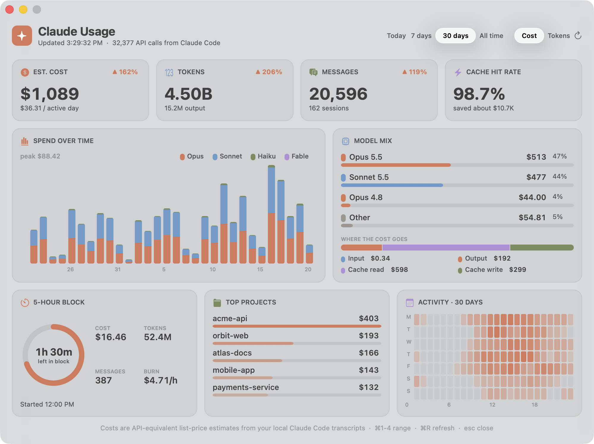
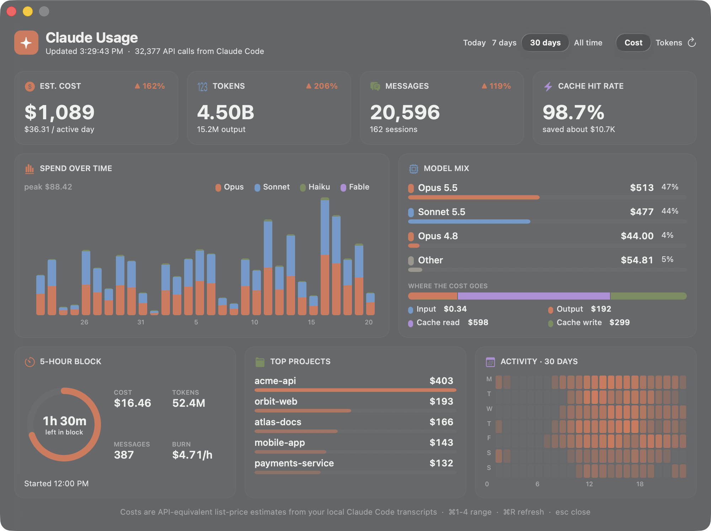

# Claude Usage for Alfred 6

A native [Alfred UI](https://www.alfredapp.com/help/alfredui/) dashboard for your Claude Code usage.
Type `claude` in Alfred and see where your tokens and money are going.

<p align="center">
  
  
</p>

_Screenshots use synthetic data generated by `tools/make_demo_data.py`._

## What you get

- **Spend, tokens, messages and cache hit rate**, with change versus the previous period
- **Stacked time chart** by model family (hourly, daily or weekly) with per-bar tooltips
- **Model mix** and **where the cost goes** (input, output, cache read, cache write)
- **Current 5-hour block** with a countdown ring, cost, tokens and burn rate
- **Top projects** and a **30-day activity heatmap** by weekday and hour
- Today / 7 days / 30 days / All time, Cost or Tokens. Light and dark mode.

| Key | Action |
| --- | --- |
| `Cmd+1` to `Cmd+4` | Today, 7 days, 30 days, All time |
| `Cmd+R` | Refresh now (it also refreshes every 30 seconds) |
| `Esc` | Close |

## Requirements

Alfred 6 with the Powerpack (Alfred UI is new in Alfred 6), macOS, and Python 3 (the macOS system
Python 3.9 is fine). No third-party packages.

## Install

Download [`Claude Usage.alfredworkflow`](https://github.com/rymawby/alfred-6-ui-claude-usage-dashboard/raw/main/dist/Claude%20Usage.alfredworkflow) and double-click it. The default keyword is `claude`
and can be changed in the workflow's configuration. You can also add a hotkey to the unassigned
Hotkey object, or fire the external trigger `dashboard`.

To build it yourself: `python3 build.py`.

## Privacy and accuracy

- Everything is read locally from `~/.claude/projects/**/*.jsonl` (set `CLAUDE_CONFIG_DIR` to use
  another location). Nothing is sent anywhere.
- The first launch indexes your whole history once (about 15 seconds for 2 GB). After that only new
  bytes are read. The cache is a SQLite file in Alfred's workflow data folder for this workflow.
- Claude Code logs the same message id once per content block, so messages are de-duplicated by id.
- **Costs are API-equivalent estimates** at Anthropic list prices, not a bill. On a subscription
  they show the value of your usage.
- The **5-hour block** is derived from your local transcripts. It is not your plan's official limit.
- Prices live in `PRICES` in `scripts/engine.py`. Update them when pricing changes.

## How it works

```
workflow/
  info.plist                      keyword, hotkey and external trigger -> Alfred UI object
  claude-usage.alfredui/
    ui.json                       window, launch event, 30s pulse
    scripts/engine.py             incremental indexer, pricing, queries
    scripts/dashboard             builds the UI JSON and swaps it into the `content` view
tools/
  make_demo_data.py               synthetic transcripts for screenshots and testing
  screenshot.sh                   renders the dashboard from demo data and captures only its window
build.py                          generates info.plist and icon, zips the .alfredworkflow
```

There is no chart component in Alfred UI, so the charts are built from `view` components with fixed
pixel sizes. That is why the window is a fixed size.

## Regenerating the screenshots

```
tools/screenshot.sh
```

This renders from synthetic data only and captures just the Alfred UI window. It deletes the capture
unless the isolated demo database exists and contains only the invented project names.

## Disclaimer

Independent project, not affiliated with or endorsed by Anthropic or Running with Crayons (Alfred).
All names are trademarks of their owners.

## License

[MIT](LICENSE)
