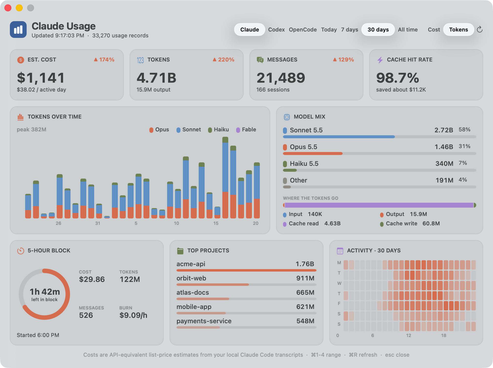
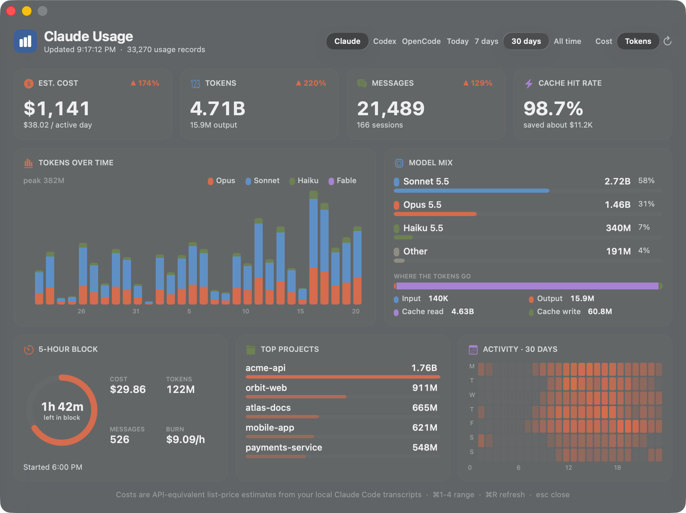
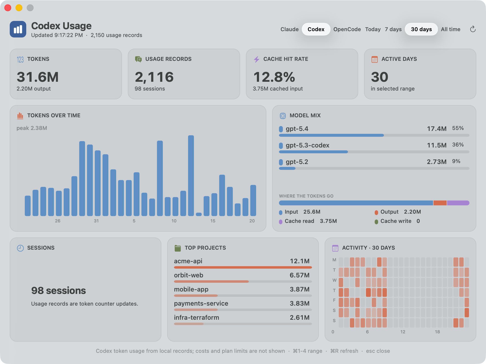
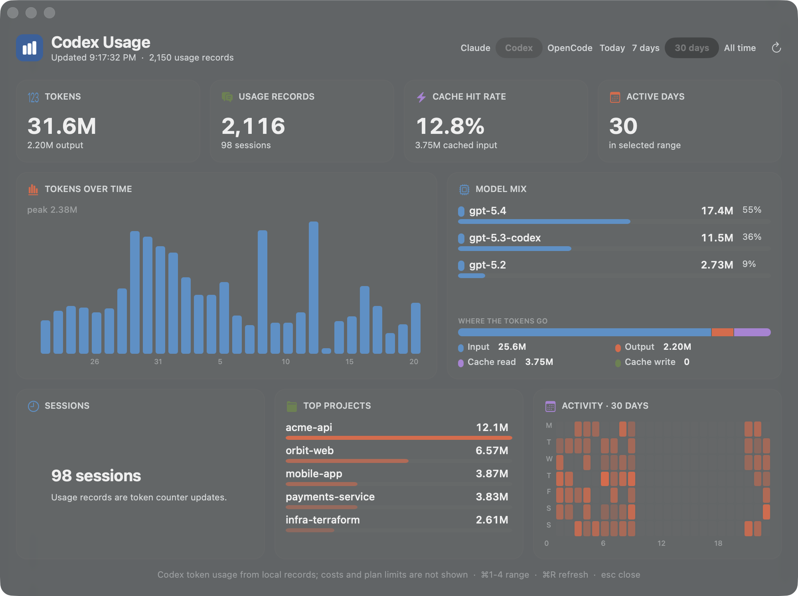
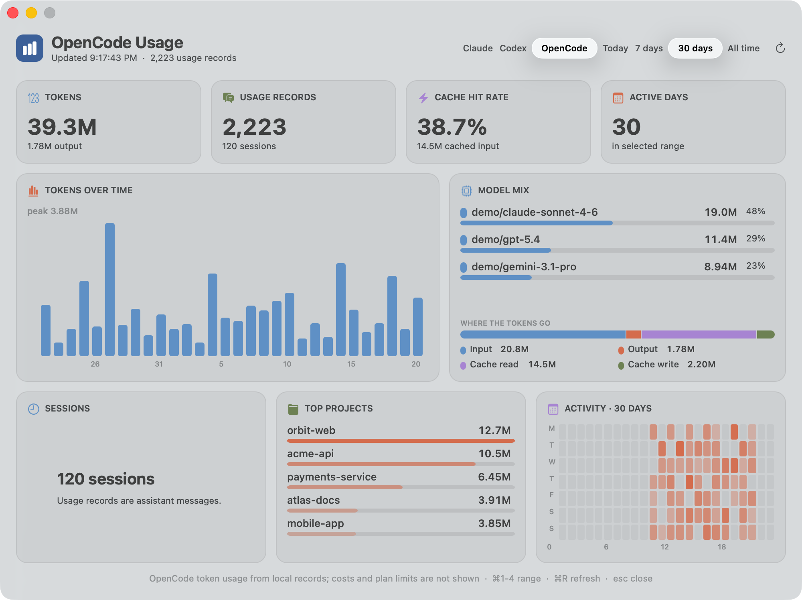
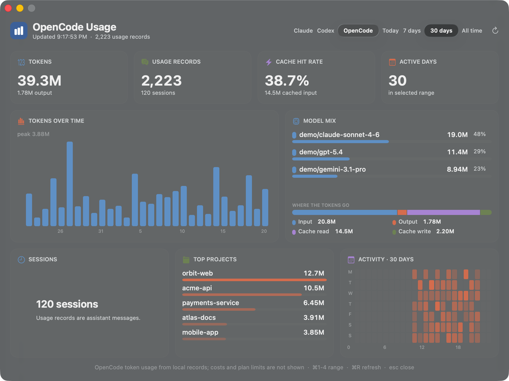

# AI Usage Stats for Alfred 6

A native [Alfred UI](https://www.alfredapp.com/help/alfredui/) dashboard for your Claude Code, Codex and OpenCode usage.
Type `usage` in Alfred, then choose Claude, Codex or OpenCode in the dashboard.

<p align="center">
  
  
</p>

<p align="center">
  
  
</p>

<p align="center">
  
  
</p>

_Screenshots use synthetic data generated by `tools/make_demo_data.py`._

## What you get

- **Tokens, usage records, sessions and cache hit rate**, with change versus the previous period
- **Claude:** estimated spend, messages and a locally derived 5-hour block
- **Codex and OpenCode:** local token usage by model, project and time; no estimated cost or plan limits
- **Time chart** by model (hourly, daily or weekly) with per-bar tooltips
- **Model mix** and **where the cost goes** (input, output, cache read, cache write)
- **Top projects** and a **30-day activity heatmap** by weekday and hour
- Today / 7 days / 30 days / All time, with Cost or Tokens for Claude. Light and dark mode.

| Key | Action |
| --- | --- |
| `Cmd+1` to `Cmd+4` | Today, 7 days, 30 days, All time |
| `Cmd+R` | Refresh now (it also refreshes every 30 seconds) |
| `Esc` | Close |

## Requirements

Alfred 6 with the Powerpack (Alfred UI is new in Alfred 6), macOS, and Python 3 (the macOS system
Python 3.9 is fine). No third-party packages.

## Install

Download [`AI-usage-stats.alfredworkflow`](https://github.com/rymawby/alfred-6-ui-ai-usage-dashboard/raw/main/dist/AI-usage-stats.alfredworkflow) and double-click it. The default keyword is `usage`
and can be changed in the workflow's configuration. You can also add a hotkey to the unassigned
Hotkey object, or fire the external trigger `dashboard`.

To build it yourself: `python3 build.py`.

## Privacy and accuracy

- Claude transcripts are read locally from `~/.claude/projects/**/*.jsonl` (or `CLAUDE_CONFIG_DIR`).
  Codex sessions are read from `~/.codex/sessions/**/*.jsonl` (or `$CODEX_HOME/sessions`).
  OpenCode reads `~/.local/share/opencode/opencode.db` (or `$XDG_DATA_HOME/opencode/opencode.db`;
  `OPENCODE_DB` overrides the path). Nothing is sent anywhere.
- The first launch indexes your history. Claude reads new bytes on later refreshes; Codex re-reads
  changed session files to calculate counter increments. OpenCode reads its database on refresh.
  Separate SQLite caches are stored in Alfred's workflow data folder.
- Claude messages are de-duplicated by id. Codex usage records are increases in cumulative session
  token counters, not messages or official quota usage. Repeated counter snapshots are ignored.
  Model and project attribution follows the most recent context in the session log. Codex log formats
  can change, and sessions without recorded token counters are not included.
- OpenCode usage records are assistant messages with recorded tokens. Input, output and cache values
  come from those messages; sessions without usage records are omitted. The legacy JSON-only OpenCode
  storage format is not supported.
- **Claude costs are API-equivalent estimates** at Anthropic list prices, not a bill. On a subscription
  they show the value of your usage.
- The Claude **5-hour block** is derived from your local transcripts. It is not your plan's official limit.
- Prices live in `PRICES` in `scripts/engine.py`. Update them when pricing changes.

## How it works

```
workflow/
  info.plist                      keyword, hotkey and external trigger -> Alfred UI object
  claude-usage.alfredui/
    ui.json                       window, launch event, 30s pulse
    scripts/engine.py             Claude indexer, pricing, queries
    scripts/codex_engine.py       Codex session counter indexer
    scripts/opencode_engine.py    OpenCode SQLite usage reader
    scripts/dashboard             builds the UI JSON and swaps it into the `content` view
tools/
  make_demo_data.py               synthetic transcripts for screenshots and testing
  screenshot.sh                   renders the dashboard from demo data and captures only its window
build.py                          generates info.plist and icon, zips the .alfredworkflow
```

There is no chart component in Alfred UI, so the charts are built from `view` components with fixed
pixel sizes. That is why the window is a fixed size.

## Regenerating the screenshots

```
tools/screenshot.sh both opencode
```

This renders from synthetic data only and captures just the Alfred UI window. It deletes the capture
unless the isolated demo database exists and contains only the invented project names.

## Disclaimer

Independent project, not affiliated with or endorsed by Anthropic, OpenAI, OpenCode, or Running with Crayons (Alfred).
All names are trademarks of their owners.

## License

[MIT](LICENSE)
